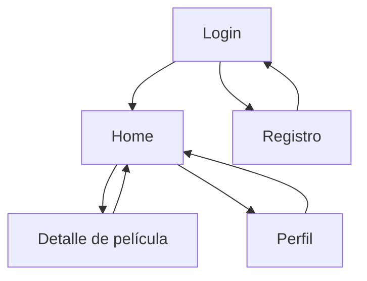

# CP7 — Flujo de navegación

## Pantallas y rutas

- `/login`: inicio de sesión.
- `/register`: registro de usuario.
- `/tabs/home`: listado y búsqueda de películas.
- `/tabs/profile`: perfil del usuario.
- `/movie/:id`: detalle de una película identificada por su ID.

## Flujo de navegación

## Estados de la pantalla de detalle

- **Cargando:** muestra un indicador mientras se consulta la película.
- **Error:** muestra un mensaje cuando falla la consulta o el ID no es válido.
- **No encontrada:** muestra un mensaje si no hay película disponible.
- **Contenido cargado:** presenta los datos de la película y permite calificarla y escribir una reseña.

## Accesibilidad y navegación

- El botón de regreso utiliza `/tabs/home` como destino predeterminado.
- Los botones de calificación tienen etiquetas accesibles.
- Los mensajes informan al usuario sobre errores y el estado del guardado de reseñas.
